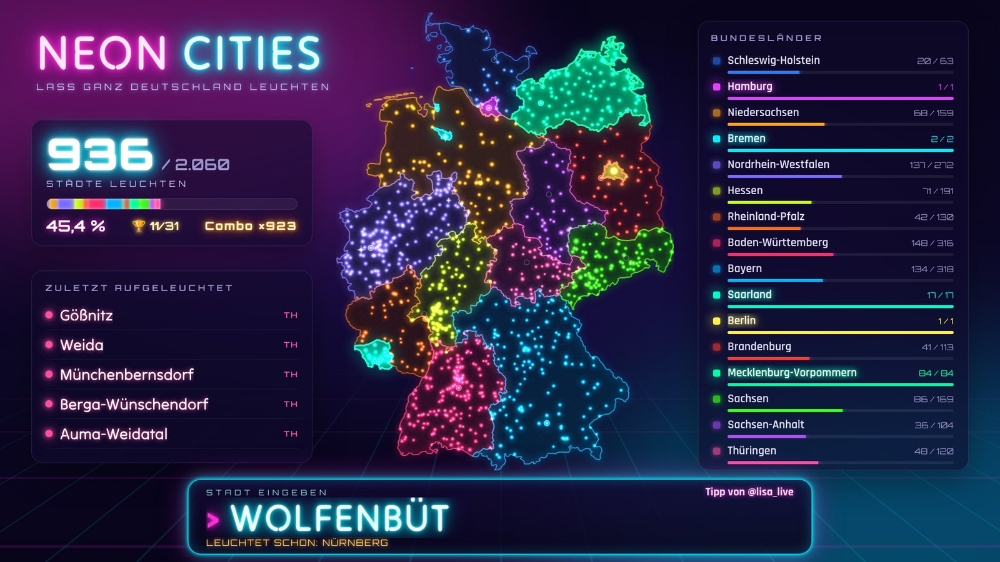
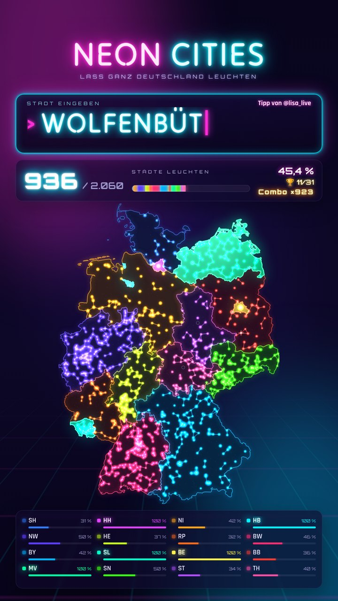
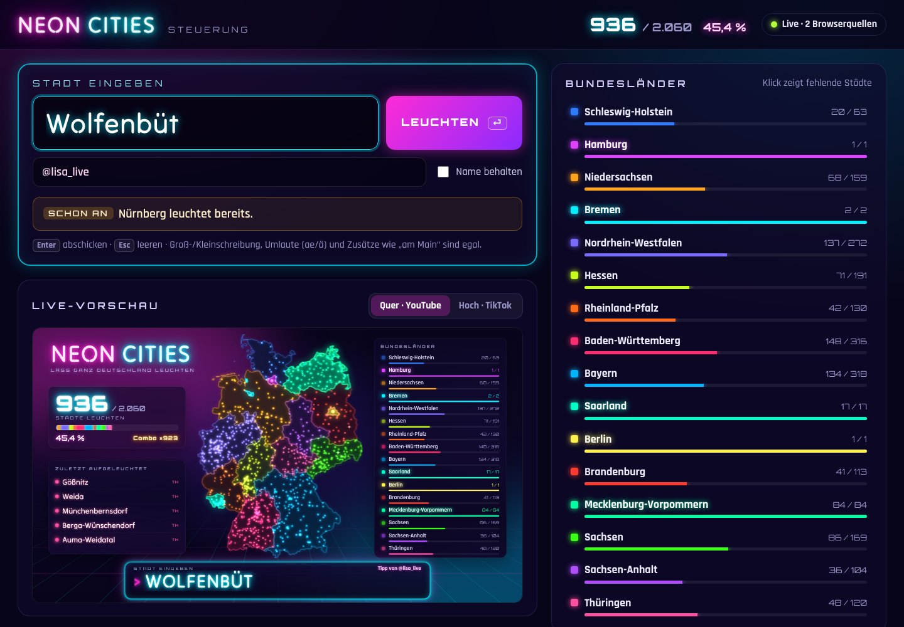
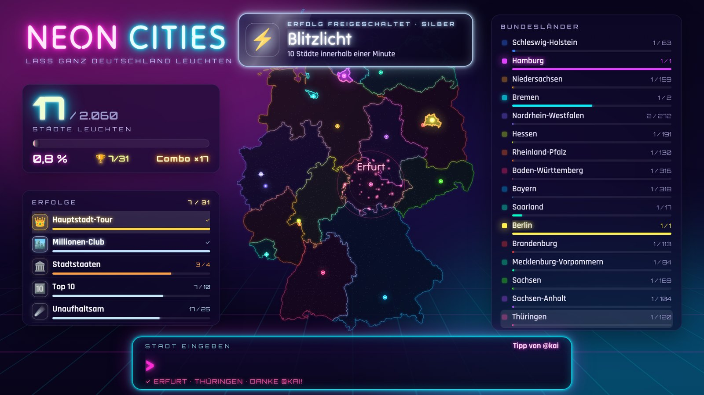

# NEON CITIES – Lass ganz Deutschland leuchten

Ein Stream-Spiel für **TikTok LIVE, YouTube und OBS**: Du tippst zusammen mit deinem Chat Städte ein, und jede gefundene Stadt leuchtet in der Neonfarbe ihres Bundeslands auf. Ziel: alle **2.060 Städte**, bis ganz Deutschland strahlt.

Jeder Buchstabe, den du tippst, erscheint **sofort live in allen Browserquellen**: in OBS, in TikTok LIVE Studio, auf dem zweiten Monitor und auf dem Handy.



| TikTok (Hochformat) | Steuerung |
| --- | --- |
|  |  |

## Das kann es

- **Alle 2.060 Städte Deutschlands** aus dem offiziellen Gemeindeverzeichnis (Stand 30.06.2026), jeweils mit Bundesland, Einwohnerzahl und Lage
- **Live-Sync für jeden Tastendruck** in alle Overlays gleichzeitig, über WebSocket und ohne Verzögerung
- **Neon-Effekte:** Ein Komet fliegt vom Eingabefeld zur Stadt, dann folgen Lichtring und Funken. Die Stadt leuchtet in ihrer Bundeslandfarbe weiter, das Bundesland wird mit jeder Stadt heller.
- **Große Momente:** Bundesland komplett, Meilensteine (100, 200 … Städte), Combo-Zähler und ein Feuerwerk-Finale, wenn ganz Deutschland leuchtet
- **31 Erfolge** wie „Hauptstadt-Tour“, „Millionen-Club“, „Ruhrpott“ oder „Die Hanse“, mit Freischalt-Animation, Sound und einer „Fast geschafft“-Liste im Overlay (mehr dazu [unten](#erfolge))
- **Sounds** (synthetisch erzeugt, abschaltbar), dazu ein leises Neon-Klicken bei jedem Buchstaben
- **Hochformat für TikTok** (1080 × 1920) und **Querformat für YouTube/OBS** (1920 × 1080), dazu Einzel-Widgets (nur Karte, nur Eingabe, nur Statistik)
- **Tolerante Erkennung:** Groß- und Kleinschreibung sind egal, `Koeln` = `Köln`, `Sankt` = `St.`, und `Frankfurt` findet beide Frankfurts. `Neustadt` lässt gleich alle 12 Neustädte aufleuchten.
- **Hinweise im Spiel:** Ist eine Eingabe nur eine Gemeinde ohne Stadtrecht, sagt das Overlay das, z. B. „Unterhaching ist eine Gemeinde in Bayern – keine Stadt“.
- **Steuerseite** mit Live-Vorschau, Rückgängig-Knopf, „Tipp von @zuschauer“ und einem Spickzettel mit den fehlenden Städten je Bundesland, den nur du siehst
- **Vom Handy aus tippen:** Die Steuerseite funktioniert im gleichen WLAN auch auf dem Handy.
- **Der Spielstand wird automatisch gespeichert** und übersteht einen Neustart.
- **Keine Installation von Paketen nötig:** Es läuft komplett offline, nur Node.js wird gebraucht.

## Schnellstart

1. **Node.js installieren** (einmalig): <https://nodejs.org> → „LTS“ herunterladen und installieren.
2. **Dieses Projekt herunterladen:** oben auf GitHub *Code → Download ZIP* und dann entpacken.
3. **Starten:**
   - **Windows:** `start.bat` doppelklicken.
   - **Mac:** `start.command` doppelklicken. Beim ersten Mal: Rechtsklick → *Öffnen*.
   - **Terminal (alle Systeme):** `npm start` oder `node server.js`
4. Die **Steuerung** öffnet sich im Browser unter <http://localhost:3000>. Dort tippst du die Städte ein.

> Fragt die Windows-Firewall nach, klicke auf **„Zugriff zulassen“**. Das ist nur nötig, wenn du vom Handy aus tippen willst.

Das Fenster mit dem Server muss während des Streams offen bleiben.

## Overlay in den Stream einbauen

Alle Links findest du auch auf der Steuerseite unter **Browserquellen**, dort kannst du sie direkt kopieren.

| Quelle | Link | Größe |
| --- | --- | --- |
| TikTok LIVE (Hochformat) | `http://localhost:3000/overlay?layout=hoch` | 1080 × 1920 |
| YouTube / OBS (Querformat) | `http://localhost:3000/overlay?layout=quer` | 1920 × 1080 |
| Nur Karte | `http://localhost:3000/overlay?view=karte` | 760 × 1030 |
| Nur Eingabe-Leiste | `http://localhost:3000/overlay?view=eingabe` | 1400 × 210 |
| Nur Statistik | `http://localhost:3000/overlay?view=statistik` | 600 × 1680 |
| Nur Erfolge | `http://localhost:3000/overlay?view=erfolge` | 640 × 1480 |

### OBS Studio / Streamlabs

1. *Quellen* → **+** → **Browser**
2. Link einfügen und Breite/Höhe wie in der Tabelle eintragen
3. Für die Sounds **„Audio über OBS steuern“** anhaken

### TikTok LIVE Studio

1. *Quelle hinzufügen* → **Link**
2. Den Hochformat-Link `http://localhost:3000/overlay?layout=hoch` einfügen
3. Auf die volle Größe (1080 × 1920) ziehen

Du kannst beliebig viele Quellen gleichzeitig benutzen. Alle bleiben synchron.

### Optionen für den Link

Hänge sie mit `&` an, z. B. `…/overlay?layout=quer&bg=0&sound=0`.

| Option | Bedeutung |
| --- | --- |
| `layout=hoch` / `layout=quer` | Hoch- oder Querformat erzwingen. Ohne Angabe wird es automatisch an der Größe der Quelle erkannt. |
| `view=karte` / `eingabe` / `statistik` / `erfolge` | nur ein Teil des Overlays (transparent) |
| `bg=0` | transparenter Hintergrund, z. B. über deiner Kamera |
| `bg=1` | dunkler Neon-Hintergrund (Standard beim kompletten Overlay) |
| `sound=0` | alle Sounds aus |
| `ticks=0` | kein Klicken beim Tippen |
| `vol=40` | Lautstärke 0–100 (Standard 60) |
| `hints=0` | noch dunkle Städte nicht als kleine Punkte zeigen |

## Erfolge



Während ihr spielt, schaltet ihr Erfolge frei. Jeder Erfolg erscheint als leuchtende Karte im Overlay, mit Sound. Gehört eine Städteliste dazu (z. B. die Hauptstädte), blitzen deren Städte auf der Karte auf. Im Overlay wechselt sich die Liste „Zuletzt aufgeleuchtet“ (im Hochformat: die Bundesländer) regelmäßig mit den Erfolgen ab, die als Nächstes fällig sind, z. B. „Hauptstadt-Tour 12 / 16“. So weiß dein Chat immer, worauf es gerade ankommt.

| Gruppe | Erfolge |
| --- | --- |
| Fortschritt | Es werde Licht (1. Stadt) · Hundert Lichter · Lichtermeer (500) · Halbzeit (1.030) · Fast taghell (1.500) · Ganz Deutschland (alle) |
| Besondere Städte | Hauptstadt-Tour (alle 16 Landeshauptstädte) · Millionen-Club · Top 10 · Großstadt-Jäger (alle 80 Großstädte) · Stadtstaaten · Ruhrpott · Die Hanse · Kompass (nördlichste/südlichste/westlichste/östlichste Stadt) · Klein, aber oho (5 kleinste Städte) · Kurz & knapp (Ulm, Hof, Aub) · Neustadt-Sammler · Kurlaub (25 „Bad“-Städte) · Am Main · Am Rhein · Donau-Welle · Von A bis Z |
| Bundesländer | Erstes Bundesland · Fünf Länder |
| Spielweise | Im Flow / Unaufhaltsam / Neon-Maschine (10er-, 25er-, 50er-Combo) · Blitzlicht (10 Städte in einer Minute) · Mega-Treffer (5 Städte mit einer Eingabe) · Teamwork / Der ganze Chat (Tipps von 10 bzw. 25 verschiedenen Zuschauern) |

Auf der Steuerseite siehst du alle Erfolge mit Fortschritt. Ein Klick auf einen Erfolg zeigt dir, welche Städte dafür noch fehlen. Die Liste siehst nur du. Erfolge bleiben freigeschaltet, auch wenn du eine Stadt zurücknimmst. Erst „Alles zurücksetzen“ setzt sie zurück.

## Vom Handy aus tippen

Beim Start zeigt das Server-Fenster eine Adresse wie `http://192.168.178.23:3000/`. Öffne sie auf dem Handy im **gleichen WLAN**. Was du dort tippst, erscheint sofort in allen Overlays und auch auf der Steuerseite am PC.

## Spielregeln & Erkennung

- Gezählt werden alle **Gemeinden mit Stadtrecht** (2.060). Gemeinden und Märkte ohne Stadtrecht zählen nicht.
- Groß- und Kleinschreibung, Leerzeichen, Bindestriche und Umlaute sind egal: `muenchen`, `Munchen` und `MÜNCHEN` funktionieren alle.
- Zusätze sind optional: `Freiburg` = Freiburg im Breisgau, `Halle` = Halle (Saale) **und** Halle (Westfalen).
- Gibt es einen Namen mehrfach, leuchten alle passenden Städte gleichzeitig auf (Mega-Treffer!).
- Bayerische Abkürzungen gehen auch: `Weiden i.d.OPf.` = Weiden in der Oberpfalz.
- Falsch eingetippt? Auf der Steuerseite unter *Zuletzt gefunden* auf **↩ zurück** klicken.

## Spielstand

Alles wird automatisch in **`spielstand.json`** im Projektordner gespeichert, nach jeder Änderung:

- alle leuchtenden Städte mit Uhrzeit und „Tipp von“-Namen
- freigeschaltete Erfolge
- laufende und beste Combo, größter Mega-Treffer

Der Fortschritt zu den nächsten Erfolgen (z. B. „Hauptstadt-Tour 12 / 16“ oder „Teamwork 7 / 10“) wird daraus berechnet und geht deshalb ebenfalls nicht verloren. Zum Sichern die Datei kopieren, bei einer neuen Version in den neuen Ordner mitnehmen.

## Online statt lokal betreiben (optional)

Der Server läuft auch bei Hostern mit WebSocket-Unterstützung (z. B. Render, Railway, Fly.io). Dann solltest du die Steuerung mit einem Passwort schützen:

```bash
NEON_KEY=geheim PORT=8080 node server.js
```

Die Steuerseite fragt dann nach dem Passwort, alternativ öffnest du sie mit `?key=geheim`. Die Overlays brauchen kein Passwort, denn sie können nur anzeigen. Mit `SAVE_FILE=/pfad/spielstand.json` legst du fest, wo der Spielstand gespeichert wird.

## Projektaufbau

```
server.js              Webserver + WebSocket-Sync (ohne Abhängigkeiten)
public/index.html      Steuerseite
public/overlay.html    Overlay / Browserquelle
public/js/game.js      Namens-Erkennung (läuft im Server und im Browser)
public/js/map.js       Neon-Karte (Canvas)
public/js/achievements.js  Erfolge (Server + Browser)
public/data/           Städte + Bundesland-Umrisse
lib/gemeinden.json     übrige Gemeinden (für „keine Stadt“-Hinweise)
tools/build-data.py    erzeugt die Daten aus den Originalquellen neu
```

## Daten & Lizenzen

- **Städte und Gemeinden:** © Statistisches Bundesamt (Destatis), Gemeindeverzeichnis-Informationssystem, Gebietsstand 30.06.2026, Bevölkerung 31.12.2024. Lizenz: [Datenlizenz Deutschland – Namensnennung – Version 2.0](https://www.govdata.de/dl-de/by-2-0).
- **Bundesland-Grenzen:** [Natural Earth](https://www.naturalearthdata.com/), gemeinfrei (Public Domain)
- **Schriften:** Tilt Neon, Orbitron, Rajdhani, alle unter der SIL Open Font License

Neue Daten einspielen: die aktuelle Datei `AuszugGV…Aktuell.xlsx` von Destatis herunterladen und `python3 tools/build-data.py <xlsx> <natural-earth.geojson>` ausführen (benötigt `openpyxl`).
